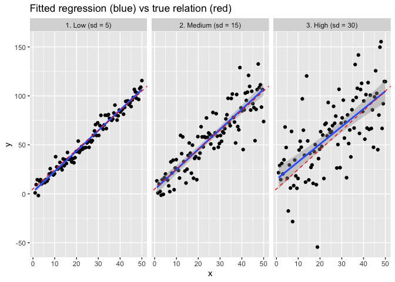
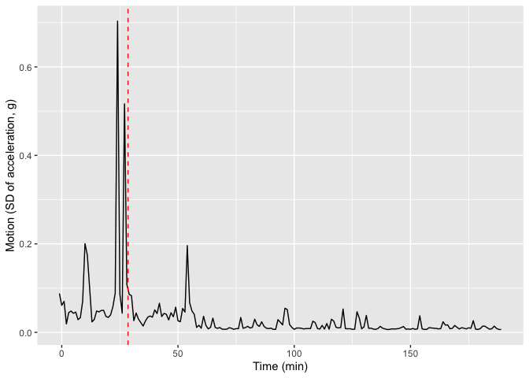
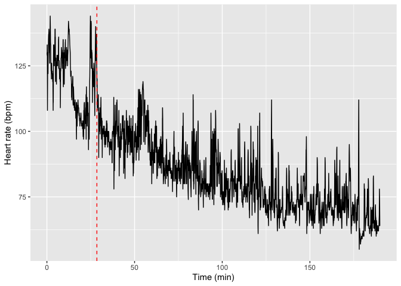
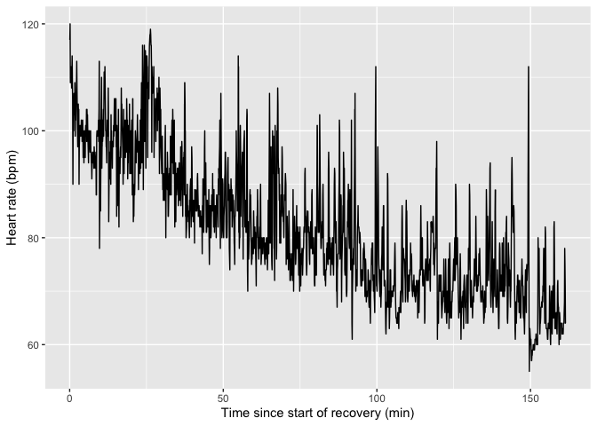
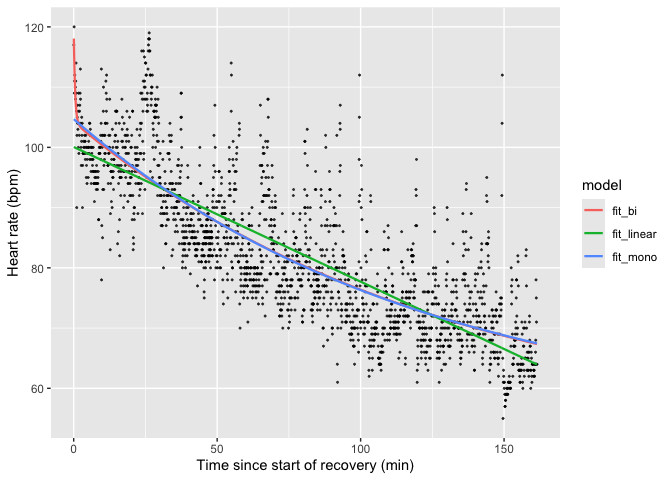
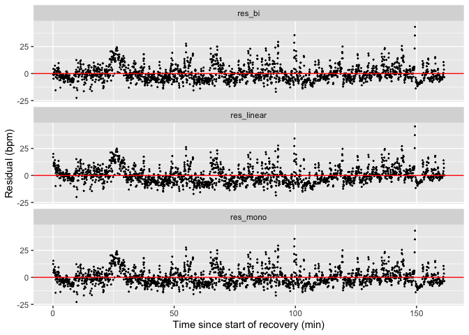
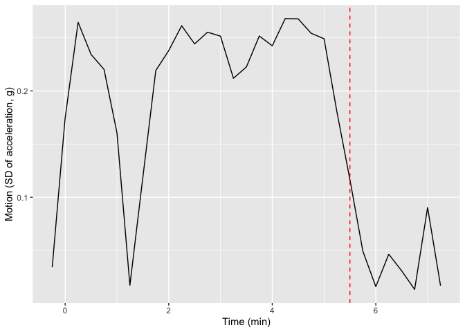
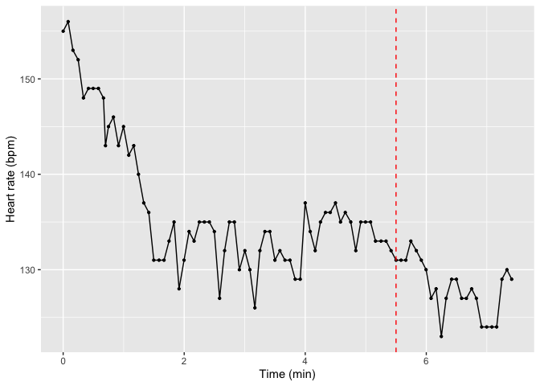
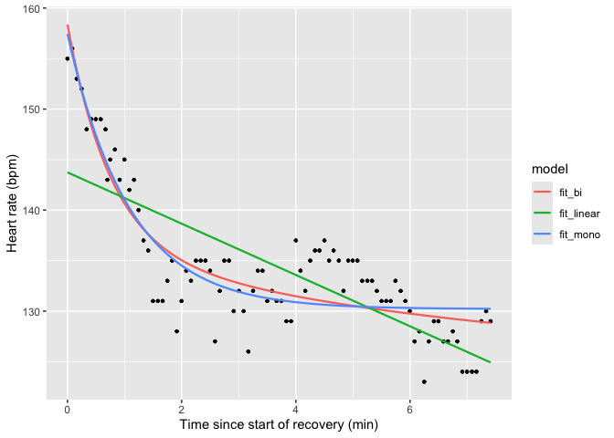
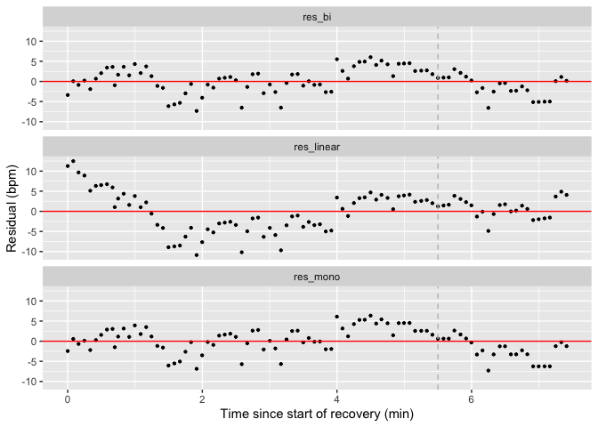

# Linear and non-linear regressions
Zoé Sauge, Gaia Gassiole, Jeanne Le Roux
2026-11-09

Repository: <https://github.com/GaiaGas/IEAP-Series04-RStudio>

# Git workflow

## Strategy

We worked in a public GitHub repository, with `main` as the reference
branch. We created the `.gitignore` before working together, and it was
completed when needed. It excludes temporary RStudio and Quarto files,
as well as rendered HTML files. Rendered HTML files had paths too long
for Windows, so we completed the .gitignore with
`*_files/libs/`, `*_files/figure-html/.`

We used a master document, `IEAP-Series04-Rstudio.qmd`, which includes
one sub-document per part. Each person mainly worked in their own file
and branch, which reduced the risk of merge conflicts:

| Part                          | Person | Branch                  |
|-------------------------------|--------|-------------------------|
| Problem 1: effect of noise    | Zoé    | `problem1`              |
| Literature and 3h10 recording | Gaia   | `problem2-3h`           |
| 7m30 recording                | Jeanne | `problem2-7m`           |
| General conclusion            | Zoé    | `problem2-conclusion`   |
| Git workflow and README       | Gaia   | `git-workflow-readme`   |
| One-page PDF report           | Jeanne | — (submitted on Moodle) |

Each part was merged into `main` through a pull request, after being
reviewed and approved by the other two members.

## Analysis of our work

The reviews were really useful in our work. First, it enabled all of us
to think critically even though one person did the literature research.
Indeed, the question whether the full 161-minute period could be
considered as recovery was useful to rethink our analysis by adding a
clear limitation. Secondly, we spotted the errors when rendering (wrong
name path and a misplaced code fence). The work was divided equally
between the members of the team. The fact that the analysis was split in
two instead of only one person making all the work was a good thing.
Having a third person write the general conclusion also helped to
connect the two analyses.

We also encountered some difficulties. Because the libraries are loaded
only in the master document, a sub-document could fail when run alone,
so the final check must always be a render of the master document. All
sub-documents are run in the same R session when the master document is
rendered, so we added suffixes such as `_3h` and `_7m` to object and
chunk names to avoid overwriting each other’s results.

Next time, we would agree on file names and heading conventions before
each working on our sub-document so we would have less modifications to
do. We would also render the master document before opening each pull
request to spot errors earlier.

# How does random noise affect linear regression?

## Expectations

We generate three data-sets from the same linear relation ($y = 2x + 5$)
and only change the amount of random noise.

- **What will happen to the estimated slope and intercept?**: noise is
  random with a mean of zero, so it should not systematically shift the
  estimates. The fitted slope and intercept should stay close to the
  true values (2 and 5) for all noise levels. However, the more noise
  there is, the further the estimates can move away from the true values
  by chance, and the larger their standard errors should be.

- **What will happen to the quality of the predictions?**: the predicted
  line should stay close to the true relation, but individual
  observations will be further from the line. The residual standard
  error should increase roughly like the noise level we add.

- **What will happen to the amount of explained variance?**: the R²
  should decrease when noise increases, because a larger part of the
  variance of $y$ comes from the noise and not from $x$.

- **Will the estimated linear relationships remain identical?** No. Even
  if the true relation is the same, the three fitted lines will be
  slightly different, because each data-set contains a different random
  sample of noise.

## Numerical experiment

### Generate the data-sets

``` r
set.seed(1234)
n <- 100
x <- seq(1, 50, length.out = n)

# same true relation: y = 2x + 5, three noise levels (sd)
data_low <- data.frame(x = x, y = 2 * x + 5 + rnorm(n, 0, 5))
data_mid <- data.frame(x = x, y = 2 * x + 5 + rnorm(n, 0, 15))
data_high <- data.frame(x = x, y = 2 * x + 5 + rnorm(n, 0, 30))
```

### Fit the models

``` r
model_low <- lm(y ~ x, data = data_low)
model_mid <- lm(y ~ x, data = data_mid)
model_high <- lm(y ~ x, data = data_high)
```

### Compare the models

``` r
results <- data.frame(
  noise_sd = c(5, 15, 30),
  intercept = c(coef(model_low)[1], coef(model_mid)[1], coef(model_high)[1]),
  slope = c(coef(model_low)[2], coef(model_mid)[2], coef(model_high)[2]),
  slope_se = c(summary(model_low)$coefficients[2, 2], summary(model_mid)$coefficients[2, 2], summary(model_high)$coefficients[2, 2]),
  r_squared = c(summary(model_low)$r.squared, summary(model_mid)$r.squared, summary(model_high)$r.squared),
  residual_se = c(sigma(model_low), sigma(model_mid), sigma(model_high))
)
results
```

      noise_sd intercept    slope   slope_se r_squared residual_se
    1        5  1.984898 2.087502 0.03420572 0.9743617    4.887056
    2       15  4.422259 2.046917 0.10881638 0.7831110   15.546865
    3       30 14.682358 1.802186 0.20164917 0.4490488   28.810114

### Visualise

``` r
data_low$noise <- "1. Low (sd = 5)"
data_mid$noise <- "2. Medium (sd = 15)"
data_high$noise <- "3. High (sd = 30)"
data_all <- rbind(data_low, data_mid, data_high)
ggplot(data_all, aes(x = x, y = y)) +
  geom_point() +
  geom_smooth(method = "lm", formula = y ~ x) +
  geom_abline(intercept = 5, slope = 2, color = "red", linetype = "dashed") +
  facet_wrap(~ noise) +
  ggtitle("Fitted regression (blue) vs true relation (red)")
```



## Conclusions

Our expectations were mostly confirmed. The estimated slopes (2.09, 2.05
and 1.8) stay close to the true value of 2. Noise therefore doesn’t seem
to bias the slope, but its standard error increases from 0.034 to 0.202,
so the estimate becomes less precise. The intercept is less stable
(1.98, 4.42 and 14.68 for a true value of 5). The largest error is found
with the highest noise, but the trend is not regular: the low-noise
model is further from 5 than the medium-noise one. This shows that one
data-set per noise level is not enough to observe a clear effect.

The quality of the fit clearly decreases with noise. The R² drops from
0.97 to 0.78 and 0.45. The residual standard error (4.9, 15.5 and 28.8)
is close to the noise level we added. As expected, the three fitted
lines are not identical, even though the underlying relation is the
same.

In conclusion, random noise doesn’t seem to change the relation the
model finds on average, but it makes the estimates less precise and the
predictions less reliable. A low R² does not necessarily mean that the
relation is wrong; it can simply mean that the data are noisy.

## A better numerical experiment

Our experiment uses only one random data-set per noise level, so the
differences we see between models partly depend on chance. To better
reproduce the theoretical expectations, we could:

- **Repeat the simulation many times** (for example 1000 data-sets per
  noise level) and look at the distribution of the estimated slopes and
  intercepts. We would expect their mean to stay at the true value and
  their spread to increase with noise.
- **Test more noise levels** to describe how R² and the standard errors
  change with noise, instead of comparing only three points.
- **Vary the sample size** to show that more data compensates for noise
  by making the estimates more precise.
- **Compare with theory**: the standard error of the slope can be
  calculated as $\sigma / \sqrt{\sum (x_i - \bar{x})^2}$ and compared
  with what we observe.

# Finding a mathematical model for heart rate recovery after exercise

## Formulate predictions from scientific literature

### What mathematical models have been proposed to describe heart rate recovery?

Pierpont et al. (2000) used a first-order (mono-exponential) decay
model. Imai et al. (1994) fitted a mono-exponential model over the first
120 s ($T_{120}$) and a semilogarithmic linear regression over the first
30 s ($T_{30}$). They also proposed that a bi-exponential model might
provide a better fit, but they did not test it.

### What physiological mechanisms explain the decrease in heart rate after exercise?

Pierpont et al. (2000) studied heart rate recovery as an index of
parasympathetic activity. In Imai et al. (1994), the initial rapid
decrease disappeared under atropine, and $T_{30}$ was markedly prolonged
by atropine but unaffected by propranolol. This suggests that early
recovery depends mainly on vagal reactivation. $T_{120}$ also depended
on sympathetic activity, which suggests that gradual sympathetic
withdrawal contributes over a longer period.

### What are the expected characteristics of the recovery curve?

We expect a rapid initial decrease, followed by a slower decrease
towards a resting value. Imai et al. (1994) observed these two
components on a semilogarithmic scale. They also found that recovery was
faster in well-trained athletes and slower in patients with chronic
heart failure. Pierpont et al. (2000) showed that the time constant
after maximal exercise depended on the duration of the data included,
whereas it became reasonably stable after submaximal exercise with at
least 180 s of data.

### Does the literature suggest that one mathematical model is sufficient to describe the entire recovery period?

These two articles suggest that one model is not always sufficient.
Pierpont et al. (2000) found that a first-order model was inadequate
after maximal exercise because of its residuals, but reasonable after
submaximal exercise. Imai et al. (1994) concluded that a
mono-exponential approximation of the overall decay is not strictly
correct. A bi-exponential model might fit better, although they cite an
earlier study that failed to show its superiority.

### Hypotheses

For the three-hour recording, we expect the linear model to perform
worst. The mono-exponential model should capture the general trend, but
may leave structured residuals. The bi-exponential model should fit
better only if the recording contains two distinct recovery phases.
However, both studies analysed only a few minutes of recovery, so their
conclusions may not transfer directly to a three-hour recording.

For the 7.5-minute recording, the duration is closer to the recovery
periods analysed by Pierpont et al. (2000) and Imai et al. (1994), so we
expect their conclusions to apply more directly. We expect a rapid
initial decrease followed by a slower one, so an exponential model
should fit better than a linear model. If these two phases are clearly
visible, the bi-exponential model should provide a meaningfully better
fit than the mono-exponential model. However, Pierpont et al. (2000)
found that the mono-exponential model was reasonable after submaximal
exercise, so it may be sufficient if the preceding effort was not
maximal.

## Test your predictions using the first dataset: 3h10 recording

### Explore the data

``` r
# Read the pulse data (timestamp in Unix ms, value in bpm)
pulse_3h <- read_csv("data/pulse_3h.csv")
```

    Rows: 2456 Columns: 2
    ── Column specification ────────────────────────────────────────────────────────
    Delimiter: ","
    dbl (2): timestamp, value

    ℹ Use `spec()` to retrieve the full column specification for this data.
    ℹ Specify the column types or set `show_col_types = FALSE` to quiet this message.

``` r
# Check the column names, first rows and number of measurements
names(pulse_3h)
```

    [1] "timestamp" "value"    

``` r
head(pulse_3h)
```

    # A tibble: 6 × 2
          timestamp value
              <dbl> <dbl>
    1 1790323201412   130
    2 1790323204642   130
    3 1790323209357   129
    4 1790323209606   129
    5 1790323210598   133
    6 1790323214568   129

``` r
nrow(pulse_3h)
```

    [1] 2456

``` r
# Sort by time, convert timestamps to minutes since the start,
# and rename the heart rate column
hr_3h <- pulse_3h |>
  arrange(timestamp) |>
  transmute(time_min = (timestamp - min(timestamp)) / 60000,
            hr = value)

# Check the converted data and the range of each variable
head(hr_3h)
```

    # A tibble: 6 × 2
      time_min    hr
         <dbl> <dbl>
    1   0        130
    2   0.0538   130
    3   0.132    129
    4   0.137    129
    5   0.153    133
    6   0.219    129

``` r
summary(hr_3h)
```

        time_min            hr        
     Min.   :  0.00   Min.   : 55.00  
     1st Qu.: 46.04   1st Qu.: 74.00  
     Median : 91.35   Median : 84.00  
     Mean   : 92.54   Mean   : 88.69  
     3rd Qu.:139.08   3rd Qu.:100.00  
     Max.   :189.96   Max.   :144.00  

``` r
# Check the time between two measurements (in seconds)
summary(diff(hr_3h$time_min) * 60)
```

       Min. 1st Qu.  Median    Mean 3rd Qu.    Max. 
      0.248   4.716   4.966   4.643   5.214  10.678 

### Identify the exercise and recovery periods

The recording has no activity labels, so we used the acceleration signal
to help identify the end of the activity. For each minute, we computed
the magnitude of the acceleration and its standard deviation. Higher
values indicate more body movement.

``` r
# Use the first pulse timestamp as the common time origin
t0_3h <- min(pulse_3h$timestamp)

# Compute body motion per minute (SD of the acceleration magnitude)
motion_3h <- read_csv("data/acceleration_3h.csv") |>
  mutate(time_min = (timestamp - t0_3h) / 60000,
         magnitude = sqrt(x^2 + y^2 + z^2),
         minute = floor(time_min)) |>
  group_by(minute) |>
  summarise(motion = sd(magnitude))
```

    Rows: 610518 Columns: 4
    ── Column specification ────────────────────────────────────────────────────────
    Delimiter: ","
    dbl (4): timestamp, x, y, z

    ℹ Use `spec()` to retrieve the full column specification for this data.
    ℹ Specify the column types or set `show_col_types = FALSE` to quiet this message.

``` r
# Set the start of recovery at the end of the last large movements
t_start_3h <- 28.5

# Show this start on the motion signal
ggplot(motion_3h, aes(x = minute, y = motion)) +
  geom_line() +
  geom_vline(xintercept = t_start_3h, color = "red", linetype = "dashed") +
  labs(x = "Time (min)", y = "Motion (SD of acceleration, g)")
```



The largest movements occurred at 24–25 and 27–28.5 minutes, so we took
28.5 minutes as the start of recovery. This remains an assumption,
because the accelerometer does not tell us what the person was doing.
Smaller movements around 54 minutes also temporarily increased heart
rate, so recovery is not uninterrupted.

### Extract and visualise heart rate as a function of time

We converted the timestamps to minutes since the start of the recording,
then plotted heart rate over the full recording. The dashed line marks
the proposed start of recovery.

``` r
# Plot heart rate over the full recording and mark the start of recovery
ggplot(hr_3h, aes(x = time_min, y = hr)) +
  geom_line() +
  geom_vline(xintercept = t_start_3h, color = "red", linetype = "dashed") +
  labs(x = "Time (min)", y = "Heart rate (bpm)")
```



Heart rate shows a general downward trend, from about 130 bpm at the
start to about 65 bpm at the end. It remains high and irregular during
the first 28.5 minutes, reaching a maximum of 144 bpm. Short peaks
persist until the end of the recording, so the decrease is not smooth.

### Identify the period corresponding to post-exercise recovery

We kept only the measurements recorded after 28.5 minutes, then reset
the time to 0 at this point. Variable `t` therefore represents the time
since the start of recovery.

``` r
# Keep the recovery period and restart time at 0
hrr_3h <- hr_3h |>
  filter(time_min >= t_start_3h) |>
  mutate(t = time_min - t_start_3h)

# Check the number of measurements and the time range
nrow(hrr_3h)
```

    [1] 2053

``` r
range(hrr_3h$t)
```

    [1]   0.0542 161.4649

``` r
# Plot heart rate during the recovery period
ggplot(hrr_3h, aes(x = t, y = hr)) +
  geom_line() +
  labs(x = "Time since start of recovery (min)", y = "Heart rate (bpm)")
```



The recovery period contains 2053 measurements and lasts about 161
minutes. Heart rate continues to decrease during this period, but
temporary increases remain visible, particularly around 25 minutes after
the start of recovery (about 54 minutes into the recording).

### Fit appropriate mathematical models to the recovery data

We fitted three models to the recovery data, where $t$ is the time since
the start of recovery (in minutes).

**Linear model:** $$HR(t) = a + b\,t$$

**Mono-exponential model:** $$HR(t) = HR_0 + A\,e^{-t/\tau}$$

**Bi-exponential model:**
$$HR(t) = HR_0 + A_1\,e^{-t/\tau_1} + A_2\,e^{-t/\tau_2}$$

$HR_0$ is the value that heart rate approaches over time, $A$, $A_1$ and
$A_2$ are amplitudes in bpm, and $\tau$, $\tau_1$ and $\tau_2$ are time
constants in minutes.

``` r
# Fit the linear model
m_lin_3h <- lm(hr ~ t, data = hrr_3h)

# Fit the mono-exponential model
m_mono_3h <- nls(hr ~ hr_rest + a * exp(-t / tau),
                 data = hrr_3h,
                 start = list(hr_rest = 60, a = 60, tau = 30))

# Fit the bi-exponential model, using one fast and one slow starting time constant
m_bi_3h <- nls(hr ~ hr_rest + a1 * exp(-t / tau1) + a2 * exp(-t / tau2),
               data = hrr_3h,
               start = list(hr_rest = 55, a1 = 10, tau1 = 1, a2 = 50, tau2 = 130),
               control = nls.control(maxiter = 500))

# Display the fitted parameters
summary(m_lin_3h)
```


    Call:
    lm(formula = hr ~ t, data = hrr_3h)

    Residuals:
        Min      1Q  Median      3Q     Max 
    -19.893  -5.321  -1.205   3.838  45.331 

    Coefficients:
                  Estimate Std. Error t value Pr(>|t|)    
    (Intercept) 100.065288   0.335454  298.30   <2e-16 ***
    t            -0.223583   0.003652  -61.23   <2e-16 ***
    ---
    Signif. codes:  0 '***' 0.001 '**' 0.01 '*' 0.05 '.' 0.1 ' ' 1

    Residual standard error: 7.579 on 2051 degrees of freedom
    Multiple R-squared:  0.6464,    Adjusted R-squared:  0.6462 
    F-statistic:  3749 on 1 and 2051 DF,  p-value: < 2.2e-16

``` r
summary(m_mono_3h)
```


    Formula: hr ~ hr_rest + a * exp(-t/tau)

    Parameters:
            Estimate Std. Error t value Pr(>|t|)    
    hr_rest   53.984      2.615   20.65   <2e-16 ***
    a         50.713      2.288   22.16   <2e-16 ***
    tau      121.880     11.459   10.64   <2e-16 ***
    ---
    Signif. codes:  0 '***' 0.001 '**' 0.01 '*' 0.05 '.' 0.1 ' ' 1

    Residual standard error: 7.369 on 2050 degrees of freedom

    Number of iterations to convergence: 5 
    Achieved convergence tolerance: 4.818e-06

``` r
summary(m_bi_3h)
```


    Formula: hr ~ hr_rest + a1 * exp(-t/tau1) + a2 * exp(-t/tau2)

    Parameters:
            Estimate Std. Error t value Pr(>|t|)    
    hr_rest  52.4819     3.0174  17.393   <2e-16 ***
    a1       15.5699     6.6180   2.353   0.0187 *  
    tau1      0.4719     0.2842   1.661   0.0970 .  
    a2       51.7182     2.6457  19.548   <2e-16 ***
    tau2    129.5224    13.4660   9.618   <2e-16 ***
    ---
    Signif. codes:  0 '***' 0.001 '**' 0.01 '*' 0.05 '.' 0.1 ' ' 1

    Residual standard error: 7.352 on 2048 degrees of freedom

    Number of iterations to convergence: 6 
    Achieved convergence tolerance: 7.054e-06

The mono-exponential model gave $HR_0$ = 54.0 bpm, $A$ = 50.7 bpm and
$\tau$ = 121.9 min. The bi-exponential model gave $HR_0$ = 52.5 bpm,
$A_1$ = 15.6 bpm, $\tau_1$ = 0.47 min, $A_2$ = 51.7 bpm and $\tau_2$ =
129.5 min. In both models, $HR_0$ is an extrapolation, because it is
below the lowest measured heart rate (55 bpm).

### Compare the fitted models using appropriate statistical indicators and residual analysis

We compared the models using AIC, BIC and the residual standard error
(RSE). Lower values indicate a better fit, and AIC and BIC also penalise
model complexity.

RSE: The residual standard error indicates the typical difference
between the measured and predicted heart rate, in bpm, and a lower value
indicates a closer fit.

AIC: The Akaike information criterion combines goodness of fit with a
penalty for each parameter, and a lower value indicates a better balance
between fit and complexity.

BIC: The Bayesian information criterion follows the same principle as
AIC but penalises additional parameters more strongly in large datasets
such as ours.

``` r
# Compare goodness of fit and model complexity
comparison_3h <- tibble(
  model = c("Linear", "Mono-exponential", "Bi-exponential"),
  parameters = c(2, 3, 5),
  AIC = c(AIC(m_lin_3h), AIC(m_mono_3h), AIC(m_bi_3h)),
  BIC = c(BIC(m_lin_3h), BIC(m_mono_3h), BIC(m_bi_3h)),
  RSE = c(sigma(m_lin_3h), sigma(m_mono_3h), sigma(m_bi_3h))
)

comparison_3h
```

    # A tibble: 3 × 5
      model            parameters    AIC    BIC   RSE
      <chr>                 <dbl>  <dbl>  <dbl> <dbl>
    1 Linear                    2 14146. 14163.  7.58
    2 Mono-exponential          3 14032. 14054.  7.37
    3 Bi-exponential            5 14025. 14058.  7.35

The linear model had the highest AIC, BIC and RSE. AIC slightly favoured
the bi-exponential model (14025 vs 14032), whereas BIC slightly favoured
the mono-exponential model (14054 vs 14058). The RSE was almost
identical for these two models (7.37 vs 7.35 bpm).

``` r
# Add the fitted values and residuals of each model to the recovery data
res_3h <- hrr_3h |>
  mutate(fit_linear = fitted(m_lin_3h),
         fit_mono = fitted(m_mono_3h),
         fit_bi = fitted(m_bi_3h),
         res_linear = residuals(m_lin_3h),
         res_mono = residuals(m_mono_3h),
         res_bi = residuals(m_bi_3h))

# Plot the data and the three fitted curves
res_3h |>
  pivot_longer(starts_with("fit_"), names_to = "model", values_to = "fit") |>
  ggplot(aes(x = t, y = hr)) +
  geom_point(size = 0.3, alpha = 0.3) +
  geom_line(aes(y = fit, color = model), linewidth = 0.8) +
  labs(x = "Time since start of recovery (min)", y = "Heart rate (bpm)")
```



The two exponential curves are very close, except during the first
minutes, when the bi-exponential curve drops rapidly.

``` r
# Plot the residuals of each model over time
res_3h |>
  pivot_longer(starts_with("res_"), names_to = "model", values_to = "residual") |>
  ggplot(aes(x = t, y = residual)) +
  geom_point(size = 0.3) +
  geom_hline(yintercept = 0, color = "red") +
  facet_wrap(~model, ncol = 1) +
  labs(x = "Time since start of recovery (min)", y = "Residual (bpm)")
```



The residuals remain structured for all three models, with waves and
peaks that the curves do not capture, particularly around 25 minutes
after the start of recovery. The bi-exponential model only clearly
changes the first minutes.

``` r
# Test the normality and autocorrelation of the residuals
tibble(
  model = c("Linear", "Mono-exponential", "Bi-exponential"),
  shapiro_p = c(shapiro.test(res_3h$res_linear)$p.value,
                shapiro.test(res_3h$res_mono)$p.value,
                shapiro.test(res_3h$res_bi)$p.value),
  autocorrelation = c(cor(head(res_3h$res_linear, -1), tail(res_3h$res_linear, -1)),
                      cor(head(res_3h$res_mono, -1), tail(res_3h$res_mono, -1)),
                      cor(head(res_3h$res_bi, -1), tail(res_3h$res_bi, -1)))
)
```

    # A tibble: 3 × 3
      model            shapiro_p autocorrelation
      <chr>                <dbl>           <dbl>
    1 Linear            1.26e-25           0.768
    2 Mono-exponential  4.75e-29           0.754
    3 Bi-exponential    3.24e-29           0.753

``` r
# Test the homoscedasticity of the linear model
bptest(m_lin_3h)
```


        studentized Breusch-Pagan test

    data:  m_lin_3h
    BP = 0.21888, df = 1, p-value = 0.6399

The residuals were not normally distributed for any model (Shapiro-Wilk,
p \< .001). Their autocorrelation was about 0.75 between consecutive
measurements, so consecutive measurements are not independent. Standard
errors and differences in AIC and BIC are therefore probably too
optimistic. The Breusch-Pagan test did not indicate heteroscedasticity
for the linear model (p = .64), but it only applies to this model here.

### Conclusion

The linear model was the worst one as hypothesised. The mono-exponential
and bi-exponential models performed similarly, with the bi-exponential
model slightly better according to AIC and the mono-exponential model
slightly better according to BIC. However, all three models left
structured residuals, which suggests that none of the models fully
captured the recovery dynamics. For the sake of simplicity, the
mono-exponential model may be preferred. Moreover, because the recovery
phase was not clearly stated in the recording, our analysis depends on
our assumed starting point.

### Limitations

Moreover, the entire 161-minute period cannot be considered as a pure
post-exercise recovery. Movements and temporary heart rate increases
persist, particularly around 54 minutes, and no activity labels are
available to separate recovery from other influences. The
mono-exponential model therefore describes the general decline of heart
rate over the recording, and its time constant should not be interpreted
as a recovery time constant.

## Test your predictions using the second dataset: 7m30 recording

### Explore the data

``` r
# Read the pulse data (timestamp in Unix ms, value in bpm)
pulse_7m <- read_csv("data/pulse7m30.csv")
```

    Rows: 91 Columns: 2
    ── Column specification ────────────────────────────────────────────────────────
    Delimiter: ","
    dbl (2): timestamp, value

    ℹ Use `spec()` to retrieve the full column specification for this data.
    ℹ Specify the column types or set `show_col_types = FALSE` to quiet this message.

``` r
# Check the column names, first rows and number of measurements
names(pulse_7m)
```

    [1] "timestamp" "value"    

``` r
head(pulse_7m)
```

    # A tibble: 6 × 2
          timestamp value
              <dbl> <dbl>
    1 1790502694847   155
    2 1790502699811   156
    3 1790502704523   153
    4 1790502709737   152
    5 1790502714948   148
    6 1790502719909   149

``` r
nrow(pulse_7m)
```

    [1] 91

``` r
# Sort by time, convert timestamps to minutes since the start,
# and rename the heart rate column
hr_7m <- pulse_7m |>
  arrange(timestamp) |>
  transmute(time_min = (timestamp - min(timestamp)) / 60000,
            hr = value)
# Check the converted data and the range of each variable
head(hr_7m)
```

    # A tibble: 6 × 2
      time_min    hr
         <dbl> <dbl>
    1   0        155
    2   0.0827   156
    3   0.161    153
    4   0.248    152
    5   0.335    148
    6   0.418    149

``` r
summary(hr_7m)
```

        time_min           hr       
     Min.   :0.000   Min.   :123.0  
     1st Qu.:1.791   1st Qu.:130.0  
     Median :3.664   Median :133.0  
     Mean   :3.674   Mean   :134.4  
     3rd Qu.:5.542   3rd Qu.:136.0  
     Max.   :7.411   Max.   :156.0  

``` r
# Check the time between two measurements (in seconds)
summary(diff(hr_7m$time_min) * 60)
```

       Min. 1st Qu.  Median    Mean 3rd Qu.    Max. 
      1.984   4.960   4.963   4.941   4.967   5.461 

The recording contains 91 heart rate values over 7.4 minutes, about one
value every 5 seconds. Heart rate ranges from 123 to 156 bpm.

### Identify the exercise and recovery periods

As for the 3h10 recording, there are no activity labels, and the
body-position signal only contains “unknown”. We therefore used the
acceleration signal again. Because the recording is short, we computed
the motion (SD of the acceleration magnitude) over 15-second windows
instead of one minute.

``` r
# Use the first pulse timestamp as the common time origin
t0_7m <- min(pulse_7m$timestamp)

# Compute body motion per 15 s (SD of the acceleration magnitude)
motion_7m <- read_csv("data/acceleration7m30.csv") |>
  mutate(time_min = (timestamp - t0_7m) / 60000,
         magnitude = sqrt(x^2 + y^2 + z^2),
         window = floor(time_min * 4) / 4) |>
  group_by(window) |>
  summarise(motion = sd(magnitude))
```

    Rows: 25418 Columns: 4
    ── Column specification ────────────────────────────────────────────────────────
    Delimiter: ","
    dbl (4): timestamp, x, y, z

    ℹ Use `spec()` to retrieve the full column specification for this data.
    ℹ Specify the column types or set `show_col_types = FALSE` to quiet this message.

``` r
# Time at which the large movements stop
t_still_7m <- 5.5

# Show this time on the motion signal
ggplot(motion_7m, aes(x = window, y = motion)) +
  geom_line() +
  geom_vline(xintercept = t_still_7m, color = "red", linetype = "dashed") +
  labs(x = "Time (min)", y = "Motion (SD of acceleration, g)")
```



The person moved during most of the recording (motion around 0.2–0.27
g), with only a short pause at about 1.25 minutes. The movements stopped
at about 5.5 minutes, after which motion stayed below 0.1 g. Heart rate
was highest at the very beginning (155–156 bpm) and decreased
immediately, so the main effort may have ended just before the start of
the recording, although the accelerometer cannot confirm what the
activity was. We therefore considered the whole recording as
post-exercise recovery, with $t = 0$ at the first measurement. However,
this is not a recovery at rest: the person kept moving until about 5.5
minutes.

### Extract and visualise heart rate as a function of time

``` r
# Plot heart rate over the full recording and mark the end of the movements
ggplot(hr_7m, aes(x = time_min, y = hr)) +
  geom_line() +
  geom_point(size = 0.8) +
  geom_vline(xintercept = t_still_7m, color = "red", linetype = "dashed") +
  labs(x = "Time (min)", y = "Heart rate (bpm)")
```



Heart rate decreased quickly from about 155 bpm to about 131 bpm during
the first 1.5 minutes. It then stayed around 131–135 bpm while the
person was still moving. After the movements stopped (dashed line), it
decreased again to about 124–129 bpm.

### Identify the period corresponding to post-exercise recovery

``` r
# The whole recording is used as recovery, time already starts at 0
hrr_7m <- hr_7m |>
  mutate(t = time_min)

# Check the number of measurements and the time range
nrow(hrr_7m)
```

    [1] 91

``` r
range(hrr_7m$t)
```

    [1] 0.000000 7.411233

The recovery period contains the 91 measurements and lasts 7.4 minutes.

### Fit appropriate mathematical models to the recovery data

We fitted the same three models as for the 3h10 recording, with $t$ in
minutes.

``` r
# Fit the linear model
m_lin_7m <- lm(hr ~ t, data = hrr_7m)

# Fit the mono-exponential model
m_mono_7m <- nls(hr ~ hr_rest + a * exp(-t / tau),
                 data = hrr_7m,
                 start = list(hr_rest = 130, a = 25, tau = 1))

# Fit the bi-exponential model
# Without limits, the slow time constant grows without end, so we limited
# the fast one to 0.05-2 min and the slow one to 2-7.5 min (recording length)
m_bi_7m <- nls(hr ~ hr_rest + a1 * exp(-t / tau1) + a2 * exp(-t / tau2),
               data = hrr_7m,
               start = list(hr_rest = 125, a1 = 20, tau1 = 0.7, a2 = 10, tau2 = 5),
               algorithm = "port",
               lower = c(hr_rest = 0, a1 = 0, tau1 = 0.05, a2 = 0, tau2 = 2),
               upper = c(hr_rest = 200, a1 = 100, tau1 = 2, a2 = 100, tau2 = 7.5))

# Display the fitted parameters
summary(m_lin_7m)
```


    Call:
    lm(formula = hr ~ t, data = hrr_7m)

    Residuals:
         Min       1Q   Median       3Q      Max 
    -10.8729  -3.3729   0.6019   3.3003  12.4753 

    Coefficients:
                Estimate Std. Error t value Pr(>|t|)    
    (Intercept) 143.7347     0.9770   147.1   <2e-16 ***
    t            -2.5390     0.2288   -11.1   <2e-16 ***
    ---
    Signif. codes:  0 '***' 0.001 '**' 0.01 '*' 0.05 '.' 0.1 ' ' 1

    Residual standard error: 4.749 on 89 degrees of freedom
    Multiple R-squared:  0.5804,    Adjusted R-squared:  0.5757 
    F-statistic: 123.1 on 1 and 89 DF,  p-value: < 2.2e-16

``` r
summary(m_mono_7m)
```


    Formula: hr ~ hr_rest + a * exp(-t/tau)

    Parameters:
            Estimate Std. Error t value Pr(>|t|)    
    hr_rest 130.2063     0.5325 244.527  < 2e-16 ***
    a        27.2357     1.7003  16.018  < 2e-16 ***
    tau       1.0833     0.1277   8.483 4.74e-13 ***
    ---
    Signif. codes:  0 '***' 0.001 '**' 0.01 '*' 0.05 '.' 0.1 ' ' 1

    Residual standard error: 3.322 on 88 degrees of freedom

    Number of iterations to convergence: 4 
    Achieved convergence tolerance: 1.002e-06

``` r
summary(m_bi_7m)
```


    Formula: hr ~ hr_rest + a1 * exp(-t/tau1) + a2 * exp(-t/tau2)

    Parameters:
            Estimate Std. Error t value Pr(>|t|)    
    hr_rest 124.4418    29.4154   4.230  5.8e-05 ***
    a1       22.1307    10.1616   2.178   0.0322 *  
    tau1      0.7539     0.3934   1.917   0.0586 .  
    a2       11.8001    19.3917   0.609   0.5445    
    tau2      7.5000    37.1337   0.202   0.8404    
    ---
    Signif. codes:  0 '***' 0.001 '**' 0.01 '*' 0.05 '.' 0.1 ' ' 1

    Residual standard error: 3.247 on 86 degrees of freedom

    Algorithm "port", convergence message: relative convergence (4)

The linear model gave $HR(t) = 143.7 - 2.54\,t$. The mono-exponential
model gave $HR_0$ = 130.2 bpm, $A$ = 27.2 bpm and $\tau$ = 1.08 min
(about 65 s). These values are physiologically plausible: the fitted
curve starts at about 157 bpm and approaches 130 bpm.

Without limits, the bi-exponential fit did not give usable values: the
slow time constant increased to extremely large values (and its
amplitude too), so that the slow component simply behaved like a
straight line. With the limits, the slow time constant stopped exactly
at the upper limit (7.5 min), and the fast component (A₁ = 22.1 bpm, τ₁
= 0.75 min) was close to the mono-exponential one. This means that the
7.4-minute recording does not contain enough information to estimate a
second, slower time constant, and the values of the slow component
depend on the limit we chose.

### Compare the fitted models using appropriate statistical indicators and residual analysis

``` r
# Compare goodness of fit and model complexity
comparison_7m <- tibble(
  model = c("Linear", "Mono-exponential", "Bi-exponential"),
  parameters = c(2, 3, 5),
  AIC = c(AIC(m_lin_7m), AIC(m_mono_7m), AIC(m_bi_7m)),
  BIC = c(BIC(m_lin_7m), BIC(m_mono_7m), BIC(m_bi_7m)),
  RSE = c(sigma(m_lin_7m), sigma(m_mono_7m), sigma(m_bi_7m))
)

comparison_7m
```

    # A tibble: 3 × 5
      model            parameters   AIC   BIC   RSE
      <chr>                 <dbl> <dbl> <dbl> <dbl>
    1 Linear                    2  546.  553.  4.75
    2 Mono-exponential          3  482.  492.  3.32
    3 Bi-exponential            5  479.  495.  3.25

The linear model was clearly the worst (AIC = 546, BIC = 553, RSE = 4.7
bpm). The two exponential models were very close: AIC slightly favoured
the bi-exponential model (479 vs 482), whereas BIC favoured the
mono-exponential model (492 vs 495). The RSE was almost identical (3.25
vs 3.32 bpm). The two extra parameters of the bi-exponential model
therefore improve the fit very little.

``` r
# Add the fitted values and residuals of each model to the recovery data
res_7m <- hrr_7m |>
  mutate(fit_linear = fitted(m_lin_7m),
         fit_mono = fitted(m_mono_7m),
         fit_bi = fitted(m_bi_7m),
         res_linear = residuals(m_lin_7m),
         res_mono = residuals(m_mono_7m),
         res_bi = residuals(m_bi_7m))

# Plot the data and the three fitted curves
res_7m |>
  pivot_longer(starts_with("fit_"), names_to = "model", values_to = "fit") |>
  ggplot(aes(x = t, y = hr)) +
  geom_point(size = 0.8) +
  geom_line(aes(y = fit, color = model), linewidth = 0.8) +
  labs(x = "Time since start of recovery (min)", y = "Heart rate (bpm)")
```



The linear model cannot follow the rapid initial decrease. The two
exponential curves are almost superimposed: they follow the rapid
decrease and then flatten out.

``` r
# Plot the residuals of each model over time
res_7m |>
  pivot_longer(starts_with("res_"), names_to = "model", values_to = "residual") |>
  ggplot(aes(x = t, y = residual)) +
  geom_point(size = 0.8) +
  geom_hline(yintercept = 0, color = "red") +
  geom_vline(xintercept = t_still_7m, color = "grey", linetype = "dashed") +
  facet_wrap(~model, ncol = 1) +
  labs(x = "Time since start of recovery (min)", y = "Residual (bpm)")
```



The residuals of the linear model form a clear U shape: the model is too
low at the start and at the end and too high in the middle. The
residuals of the exponential models are smaller but still structured.
They are positive between about 4 and 5.5 minutes (heart rate higher
than predicted, while the person was still moving) and negative after 6
minutes (heart rate lower than predicted, after the movements stopped).

``` r
# Test the normality and autocorrelation of the residuals
tibble(
  model = c("Linear", "Mono-exponential", "Bi-exponential"),
  shapiro_p = c(shapiro.test(res_7m$res_linear)$p.value,
                shapiro.test(res_7m$res_mono)$p.value,
                shapiro.test(res_7m$res_bi)$p.value),
  autocorrelation = c(cor(head(res_7m$res_linear, -1), tail(res_7m$res_linear, -1)),
                      cor(head(res_7m$res_mono, -1), tail(res_7m$res_mono, -1)),
                      cor(head(res_7m$res_bi, -1), tail(res_7m$res_bi, -1)))
)
```

    # A tibble: 3 × 3
      model            shapiro_p autocorrelation
      <chr>                <dbl>           <dbl>
    1 Linear              0.522            0.843
    2 Mono-exponential    0.0701           0.689
    3 Bi-exponential      0.0969           0.664

``` r
# Test the homoscedasticity of the linear model
bptest(m_lin_7m)
```


        studentized Breusch-Pagan test

    data:  m_lin_7m
    BP = 23.403, df = 1, p-value = 1.314e-06

The Shapiro-Wilk test did not reject normality for any model (p = .52
for the linear model, .07 for the mono-exponential and .10 for the
bi-exponential model), but with only 91 values this test has limited
power. The autocorrelation between consecutive residuals was high (0.84
for the linear model, 0.69 and 0.66 for the exponential models), so the
residuals are not independent and the standard errors, AIC and BIC are
probably too optimistic. The Breusch-Pagan test indicated
heteroscedasticity for the linear model (BP = 23.4, p \< .001), which is
consistent with its larger residuals at the start of the recording.

### Conclusion

As hypothesised, an exponential model fitted the 7m30 recording much
better than a linear model. Heart rate decreased rapidly at first, with
a time constant of about 1 minute, then more slowly. The bi-exponential
model was not justified: it improved the fit very little (better AIC but
worse BIC), and its slow time constant could not be estimated within 7.4
minutes. The mono-exponential model is therefore the best compromise
between fit, simplicity and physiological interpretation, which is
consistent with Pierpont et al. (2000), who found the mono-exponential
model reasonable after submaximal exercise, although the intensity of
the preceding effort is unknown here.

However, the remaining structure in the residuals shows that recovery
was not a single smooth decay. The second decrease in heart rate
occurred when the person stopped moving at about 5.5 minutes. It is
therefore probably due to a change in activity rather than to a second
physiological recovery phase, and an exponential model cannot represent
such a change.

### Limitations

The recording starts after the end of the exercise, so we do not know
the exercise intensity, its duration or the peak heart rate. The person
kept moving during most of the recording, so this is not a recovery at
rest and the time constant also reflects this lower activity. The
recording is short (91 values), which limits the precision of the
estimates and the power of the statistical tests. Finally, the
bi-exponential results depend on the limits we imposed on the time
constants.

## Draw conclusions: comparison of the two recordings

``` r
# Combine the model comparisons of both recordings
bind_rows(
  mutate(comparison_3h, recording = "3h10"),
  mutate(comparison_7m, recording = "7m30")
)
```

    # A tibble: 6 × 6
      model            parameters    AIC    BIC   RSE recording
      <chr>                 <dbl>  <dbl>  <dbl> <dbl> <chr>    
    1 Linear                    2 14146. 14163.  7.58 3h10     
    2 Mono-exponential          3 14032. 14054.  7.37 3h10     
    3 Bi-exponential            5 14025. 14058.  7.35 3h10     
    4 Linear                    2   546.   553.  4.75 7m30     
    5 Mono-exponential          3   482.   492.  3.32 7m30     
    6 Bi-exponential            5   479.   495.  3.25 7m30     

### Were our hypotheses supported?

Our hypotheses were partly supported. As expected, the linear model was
the worst in both recordings, and an exponential model described the
decrease in heart rate much better. However, the bi-exponential model
did not provide a meaningfully better fit in either recording: AIC
slightly favoured it, whereas BIC favoured the mono-exponential model,
and the residual standard errors were almost identical.

### Does the same model describe both recordings?

The mono-exponential model was the best compromise for both recordings,
but its parameters were very different. In the 7m30 recording, the time
constant was about 1 minute and heart rate approached 130 bpm, which
corresponds to the fast early recovery described in the literature. In
the 3h10 recording, the time constant was about 122 minutes and heart
rate approached 54 bpm, which rather describes the general decline of
heart rate over the recording, not necessarily a recovery process. The
same equation therefore fits both recordings, but it does not describe
the same process, and the parameters cannot be compared directly.

### Are there different recovery phases?

The literature describes a rapid vagal phase followed by a slower phase
linked to sympathetic withdrawal (Imai et al., 1994). Our data show a
rapid initial decrease followed by a slower one, but we could not
clearly separate two physiological phases. In the 3h10 recording, the
fast component of the bi-exponential model only concerned the first
minutes and improved the fit very little. In the 7m30 recording, the
second decrease occurred when the person stopped moving, so it was
probably due to a change in activity rather than to a second recovery
phase.

### Limitations

Both recordings have the same main limitations. There were no activity
labels, so the exercise intensity is unknown. For the 3h10 recording,
the start of recovery had to be estimated from the acceleration signal,
and the full 161-minute period cannot be considered as a pure
post-exercise recovery. For the 7m30 recording, recovery was simply
assumed to start at the first measurement. In both cases, movements
occurred during the recovery, so it was not a recovery at rest. The
residuals were strongly autocorrelated, so the standard errors, AIC and
BIC are probably too optimistic. Finally, we analysed only one recording
of each type, so our results cannot be generalised.

### Which model would we choose?

We would choose the mono-exponential model,
$HR(t) = HR_0 + A\,e^{-t/\tau}$, to describe heart rate recovery after
exercise. It was the best compromise between goodness of fit and
simplicity in both recordings, it is used in the literature, although
its validity depends on the conditions (Imai et al., 1994; Pierpont et
al., 2000), and its parameters are easy to interpret: $HR_0$ is the
value heart rate approaches and $\tau$ describes the speed of recovery.
To estimate a meaningful recovery time constant, this model should be
fitted to the first minutes after the end of exercise, at rest, with
known exercise intensity. A bi-exponential model would only be justified
with a longer, controlled recording in which two phases are clearly
visible.

# References

<div id="refs" class="references csl-bib-body hanging-indent"
entry-spacing="0" line-spacing="2">

<div id="ref-imai1994" class="csl-entry">

Imai, K., Sato, H., Hori, M., Kusuoka, H., Ozaki, H., Yokoyama, H.,
Takeda, H., Inoue, M., & Kamada, T. (1994). Vagally mediated heart rate
recovery after exercise is accelerated in athletes but blunted in
patients with chronic heart failure. *Journal of the American College of
Cardiology*, *24*(6), 1529–1535.
<https://doi.org/10.1016/0735-1097(94)90150-3>

</div>

<div id="ref-pierpont2000" class="csl-entry">

Pierpont, G. L., Stolpman, D. R., & Gornick, C. C. (2000). Heart rate
recovery post-exercise as an index of parasympathetic activity. *Journal
of the Autonomic Nervous System*, *80*(3), 169–174.
<https://doi.org/10.1016/S0165-1838(00)00090-4>

</div>

</div>
